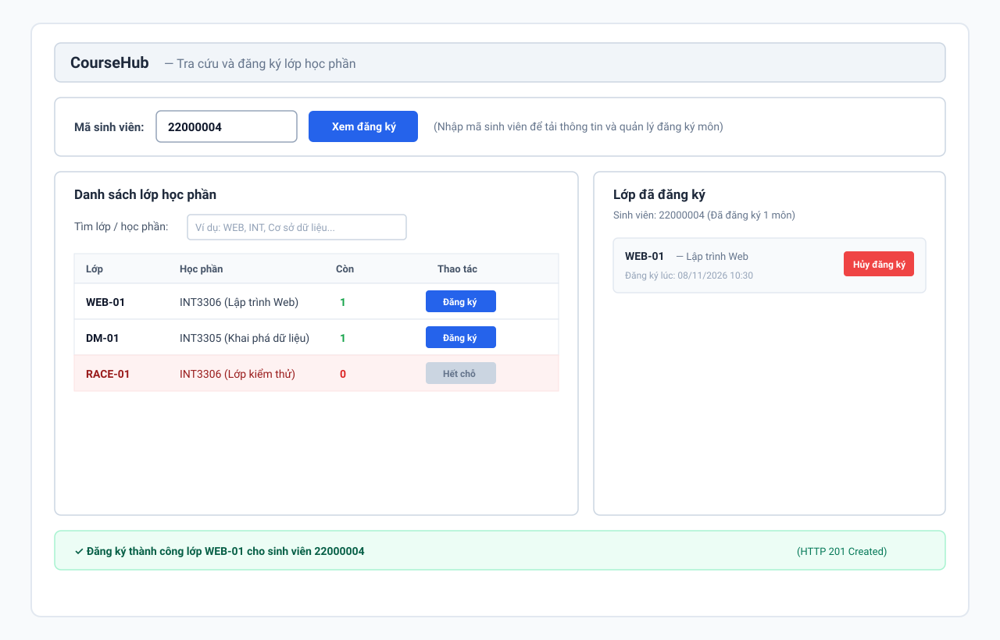

# Ghi chú Buổi 5 - Frontend React & FastAPI

## I. Phác thảo giao diện (Wireframe - Mục V)

- **Link thiết kế Figma:** [CourseHub – Buổi 5](https://www.figma.com/design/aqSCrtGrDdI2m4vIRLuxmI/CourseHub-%E2%80%93-Bu%E1%BB%95i-5?node-id=6-2&t=zet7929XTzO91w87-1)
- **Bản phác cục bộ:** [wireframe_buoi5.svg](./wireframe_buoi5.svg)

---

### Các vùng chức năng và Component tương ứng

| Vùng giao diện | Tệp Component | Dữ liệu & Nghiệp vụ |
| :--- | :--- | :--- |
| **Thanh tiêu đề & Chọn sinh viên** | `App.jsx` | Quản lý `studentId`, nút **Xem đăng ký** để nạp danh sách môn. |
| **Danh sách lớp học phần (Bên trái)** | `SectionTable.jsx` | Hiển thị bảng lớp học phần (`WEB-01`, `DM-01`, `RACE-01`). Nút **Đăng ký** khi còn chỗ (`remaining > 0`), nút xám **Hết chỗ** (`disabled`) khi `remaining = 0`. |
| **Lớp đã đăng ký (Bên phải)** | `EnrollmentList.jsx` | Hiển thị các lớp mà sinh viên đang chọn đã đăng ký thành công. Kèm nút đỏ **Hủy đăng ký**. |
| **Khung thông báo (Dưới cùng)** | `Notice.jsx` | Hiển thị kết quả thành công (xanh lá) hoặc mã lỗi như 404, 409 Hết chỗ (đỏ). |

---

### Quy ước trạng thái kiểm thử (Bước 3)
1. **Lớp còn chỗ (`WEB-01`):** `capacity = 3`, `enrolled = 2`, `remaining = 1` $\rightarrow$ Nút **Đăng ký** màu xanh, bấm gửi request `POST /enrollments` thành công (HTTP 201).
2. **Lớp hết chỗ (`RACE-01`):** `capacity = 1`, `enrolled = 1`, `remaining = 0` $\rightarrow$ Nút xám **Hết chỗ**, nếu cố tình gọi API sẽ nhận mã lỗi xung đột HTTP 409.
